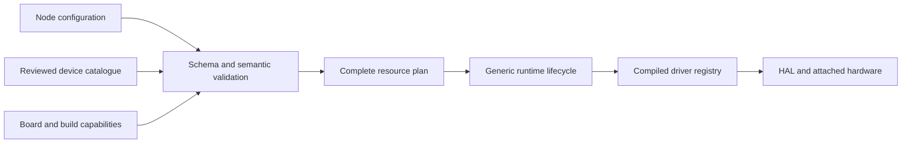

# Configuration-driven platform baseline

Baseline **2.1.0**, updated on 2026-09-28. This supersedes baseline 1.0.0's
prototype-wide device restrictions. The objective is one reusable firmware
image whose supported hardware instances, behaviour and routing are selected
through validated configuration. The original sensors and display are examples
used to evaluate that architecture.

Current status (2026-10-12): software through checkpoints 6c/7; hardware
acceptance (8) is partial. Offline preparation now starts with the
[discovery and device-specific settings contract](docs/DEVICE_DISCOVERY.md)
before model training (9). D1/D2 now add catalogue policies, bounded generic I2C
observations, USB exchange and deterministic PC identity matching. D3 now adds
sourced settings and additive draft review in the existing local UI. D4 adds
receive-only radar candidates and explicit manual OLED/GPIO confirmation, using
the same review/apply path. Physical discovery acceptance remains pending;
model training has not started.
Later checkpoint sections preserve the state when recorded.

The current implementation sequence is in
[INTEGRATION_PLAN.md](INTEGRATION_PLAN.md). The
[shared integration contracts](firmware/CONTRACTS.md) define sample records,
ownership, whole-plan replacement and the remaining memory accounting. The host
planner admits at most one enabled consumer per FIFO queue; multiple producers
remain supported. Target activation now checks declared consumer masks; the
binding adapter must map the validated routes to those masks.

## What adaptation means

- Change timing, priorities within the application range, routing and enabled
  instances through configuration, without rebuilding firmware.
- Add another instance of a driver already included in the selected build,
  subject to its supported capabilities, addresses, pins and resource limits.
- Add a reviewed descriptor for a compatible device without changing the node
  schema or generic runtime. The existing driver must actually implement its
  operations; a new descriptor does not create driver functionality.
- Add new driver logic through a firmware build and registry entry. Keep the
  runtime and planner independent of that driver's identity.
- Reject unavailable drivers, unknown descriptor versions and resource conflicts.

Automatic identification, arbitrary datasheet interpretation and electrical
hot-plug support are not acceptance requirements for this foundation.
The newly requested discovery extension adds bounded identification on reviewed
connections, with manual confirmation where needed. It does not add arbitrary
datasheet interpretation or electrical hot-plug support. This extension is being
implemented separately without changing the existing configuration contracts.

## Responsibilities and versioned contracts

| Contract | Version | Owns |
|---|---|---|
| Node schema | 2.1.0 (2.0.0 input retained) | Instances, connections, behaviour, queues, tasks and bounded rules |
| Device descriptor | 1.0.0 | Driver identity, protocol, accepted settings, execution mapping, sample types and constraints |
| Board capabilities | 1.0.0 | Available controllers/pins, reserved resources and bounded capacity |
| Build manifest | 1.0.0 | Drivers available in a particular host model or firmware build |
| Normalized host plan | 1.0.0 | Validated per-instance settings and resource demand for an adapter |
| Discovery policy catalogue | 0.1.0 | PC-side identification evidence and confirmation rules; references existing descriptors; firmware returns raw observations |

Descriptors are reviewed files under `catalogue/devices/`. They are not copied
from untrusted node requests. Node profiles cannot widen their limits. Device
IDs identify instances; driver IDs identify implementations; descriptor IDs and
versions identify device capabilities. Two instances may share a driver and
must have distinct state and physical bindings.

New device entries normally require a descriptor version and build capability
update, not a node schema or platform version change. Breaking field meanings
require a corresponding contract version change. Old node schema 1.0.0 is
rejected, with no silent migration. The legacy AI 0.2.0 contract is not a
platform contract and is not accepted as a node configuration.

## Execution architecture



The host planner is `tools/config_validator/planner.py`. It resolves descriptors,
validates their settings, checks the selected build, reserves unique wiring and
addresses, checks queue types and calculates task/stack/queue payload demand.
It does not open a serial port or activate a device. The local configurator calls this same admission layer and the existing USB
client. See [its usage](tools/configurator/README.md).

The compiled C registry uses Member 1's `component_operations_t` interface
for configure/read/write/publish. Entries bind implementations to instance-owned
contexts. The descriptor's JSON constraints and compiled driver's checks must
agree; firmware always validates independently of the host.

The runtime consumes generic instance IDs and scheduling values. Device register
maps, command sequences and scaling stay inside drivers. New behaviour kinds
may require adapter support; a descriptor cannot introduce executable code or
an unimplemented operation by naming it.

## Capacity and configuration policy

The selected deployment board remains the ESP32-C3 SuperMini. The pinned kernel,
SDK selection and setup instructions remain in
[SETUP_ESP32C3.md](firmware/SETUP_ESP32C3.md). On 2026-09-28, COM8 was verified as
an ESP32-C3 revision 0.4 with 4 MB flash. The pinned task example built with the
ESP-IDF 6.1 compatibility patch and passed startup plus repeated USB-reset checks:
each complete capture showed the kernel handover and A/B counters 0 through 24.
See [the build and board evidence](firmware/qualification/README.md). Subsequent
worker and typed-plan activation tests passed on the board, most recently 514
checks on each of two reset runs. Peripheral adapters, timing accuracy and
power-cycle behaviour still require their own acceptance checks.

The current board profile admits up to eight configured instances, four active
peripheral tasks, four queues, depth eight and 64 bytes per queue item. Reserve
at most 16 KiB of active peripheral task stacks; fixed service stacks, driver
contexts, queues and kernel overhead need separate accounting. These are
bounded implementation capacities, not a list of four supported device models.

Application task priorities are configurable from 5 through 19. Reserve higher
urgency for the health supervisor (4), and use 20/24/32 for USB/AI/idle services.
Descriptor defaults are starting values, not fixed model-to-priority mappings.
Actual schedulability still needs measurement with the requested workload.

Wiring remains reserved for all configured instances, even if disabled:
software disable does not electrically disconnect a device. Disabled instances
consume no host-model task or stack slot. Shared I2C devices need distinct
addresses; shared SPI devices need distinct control pins; the selected UART
backend has one owner per controller. Preserve the board's USB/boot constraints.

## Activation and rollback

Host admission must finish before state changes. Member 1's lifecycle, queue,
health and runtime-port modules are now reconciled with this baseline on the
host. `runtime_apply_bound_devices` accepts admitted scheduling values
and independently owned component bindings resolved through the compiled
registry. The compatibility `apply_devices` API accepts scheduling only.

Host lifecycle operations checkpoint both runtime metadata and backend task
slots. Failed prepare/start/stop/reconfigure restores the preceding working
state; a failed restoration quarantines the runtime and blocks dispatch and
further changes. Stack-size changes recreate the host task resource. Successful
whole-plan replacement resets runtime counters. Stop retains the borrowed
component binding until explicit unbind or successful replacement.

Bound periodic instances execute one bounded driver step when due; long time
jumps record skipped periods instead of replaying stale reads. Stream instances
use explicit readiness dispatch. Calls must be serialized; this host model
creates no threads. Queues and watchdogs are separate host modules and are not
automatically enrolled, replaced or rolled back by the runtime. Driver I/O is
excluded from lifecycle transactions, so caller-owned driver state and queue
contents are not transactionally restored.

The target periodic-worker port now implements dormant task creation, bounded
cooperative stop, cleanup before deletion and a kernel operating-time clock.
It requires explicit worker/context bindings and one lifecycle owner task.
The target now uses a separate small `activate` module for checked whole-plan
replacement and recovery, with `shared` wrappers for queue/health/watchdog
synchronization. Failed cleanup retains contexts and task handles. Its typed
plan validates worker/queue limits and declared consumers before teardown.
The host runtime's target transaction and scheduling-only prepare paths still
reject calls; an unselected kernel build rejects initialization too.
See [the activation contract](firmware/src/runtime/ACTIVATION.md).
Complete descriptor/wiring admission and real driver bindings are still needed
on target. Persist the last-known-good profile only after successful activation.
External hardware recovery, stream readiness, USB transfer and atomic flash
recovery remain outstanding.
See [the runtime integration record](firmware/src/runtime/INTEGRATION.md).

## Example deployments and acceptance evidence

- `configs/nodes/first-prototype.json`: four representative protocol devices.
- `configs/nodes/two-environment-sensors.json`: one shared bus, two addresses,
  independent instance names, periods, priorities and output queues.
- `configs/nodes/distance-only.json`: one GPIO device with no display dependency.

All use the same node schema and host runtime binary. The foundation suite checks
configuration replacement, reconfiguration, disable/enable, independent state,
invalid-candidate preservation, capacity errors, and a test-only additional
descriptor/driver without editing the planner or generic runtime.

Run from the repository root:

```powershell
python -m pip install -r tools/requirements.txt
python -B -m unittest discover -s tests/foundation -v
python -B -m unittest discover -s tests/runtime -v
python -B -m tools.config_validator configs/nodes/two-environment-sensors.json --build-manifest configs/builds/host-reference.json
```

GCC is required for the native tests. The host manifest explicitly represents
contract fixtures, not hardware support. `configs/builds/target-pending.json`
currently advertises no peripheral adapters and must reject peripheral plans.
A real firmware manifest must be produced from its compiled registry.

The I2C/BMP388 software path now supplies a reusable bus backend and a separate
registry adapter, tested with two independent sensor contexts on one fake bus.
It builds for C3; physical sensor acceptance awaits wiring. This is a typed
integration path, not the pending JSON/USB application. See
[the driver integration boundary](firmware/drivers/bmp388/INTEGRATION.md).
The runtime remains independent of device identities.

## Team integration and AI gate

| Owner | Integration task |
|---|---|
| Member 1 | Review the qualified periodic activation/recovery path; integrate stream readiness and real driver ownership |
| Member 2 | Bind I2C/SPI drivers to separate instance contexts; verify descriptor limits and sample representations |
| Member 3 | Bind UART/GPIO drivers; honour exclusive UART ownership and instance resource cleanup |
| Member 4 | Settle device discovery and recommended settings, then define capability-based AI inputs; training follows the discovery checkpoints |
| Member 5 | Migrate schema 1.0.0 consumers to 2.0.0; use shared validation and runtime plan mapping; integrate transfer/recovery |

The component API originates from Member 1's `feat/component-operations`, commit
`7afafe6580f93c0521fe90e2120cc2f381d51430`. Runtime, messaging and health integration
uses the locally available `origin/feat/runtime-utkernel-adapter` at
`2cd87412cf4684e7d7e0be9f0e50e19b7ec48eb3`. Remote refresh required GitHub
credentials, so newer upstream commits could not be checked during this pass.
This is a local source reconciliation, not a Git merge or publication. The
shared-header changes remain ready for team review; other members' peripheral
and configurator branches still require integration.

Model training remains on hold while discovery preparation proceeds. A later
recommender should use reviewed capabilities, workload goals and available
resources. Its outputs must pass this same validator.
It must not infer driver availability, invent wiring or expand device limits.
Keep synthetic policy labels distinct from hardware evidence. No model is required
to prove the platform can reconfigure supported hardware.

## SPI/OLED software checkpoint

Reusable SPI, independent OLED frames and shared C3 pin ownership are now
implemented and build-verified. Pixel formatting, remaining protocols and
profile deployment are pending. Physical peripheral tests wait until final
acceptance at the user's request. Target capabilities remain empty and AI stays
last. See [the checkpoint plan](INTEGRATION_PLAN.md).

## UART/radar software checkpoint

Portable UART ownership, the native C3 UART1 wrapper, streaming LD2450 parsing
and typed queue/health integration are implemented. Drivers use independent
contexts; the C3 port admits one UART instance. The runtime stays generic.
The stream currently uses an explicit bounded periodic polling adapter.
See [binding and remaining limits](firmware/drivers/hlk_ld2450/INTEGRATION.md).
Hardware acceptance, target profile deployment and AI remain pending.

## GPIO distance/PWM software checkpoint

Generic digital input, pulse capture and PWM now have portable interfaces and
C3 implementations. HC-SR04 supplies typed distance samples through its own
adapter; PWM is a generic output component. Drivers still bind through the
same registry without changing runtime behavior. See
[the checkpoint record](firmware/drivers/hc_sr04/INTEGRATION.md).
Software verification does not qualify physical timing or add deployment
capabilities. Configuration transfer/storage is next; AI remains deferred.

## Configuration core checkpoint

Portable transfer framing, explicit active/saved revisions, exact request retries
and two-slot storage recovery are now software/build verified. They require
independent validation and activation callbacks; production JSON parsing,
target admission/binding and USB/flash adapters are not connected yet.
See [the contract and remaining work](firmware/src/config/TRANSFER.md).
This is checkpoint 5a, with no change to target advertised drivers or AI scope.

## Target admission and binding checkpoint

Independent target JSON admission now connects to the controller/activation
manager for BMP388, LD2450 and HC-SR04. Instance contexts remain independent;
shared buses have whole-plan lifetime and explicit recovery to empty.
The runtime retains generic component/resource hooks.

See [current support and restrictions](firmware/src/config/ADMISSION.md).
OLED rendering, actuator routing and USB/storage application integration remain
pending. Target capabilities stay empty pending acceptance. No hardware or AI
qualification is claimed.

## USB/storage application checkpoint

Checkpoint 5c now supplies a build-selectable configuration application, native
USB pump and dedicated two-slot flash partition, connected to existing target
admission and checked activation. A read-only probe supports host reconnects;
active/saved state remains distinct. See
[current contracts and limitations](firmware/src/config/USB_STORAGE.md).

The implementation is modular and the application loop is independent of sensor
identity. Hardware acceptance and target capability advertising remain pending;
no board image was replaced. Next are services/local UI, generic rules/outputs,
physical acceptance/readiness, then AI. Earlier checkpoint notes are historical.

## Telemetry and health checkpoint

Checkpoint 6a adds independent per-source observations, freshness/fault status,
owner-loop heartbeat supervision and read-only USB snapshots. The local command
prints the same generic types as JSON; source IDs and routes come from the active
configuration. See [current contracts](firmware/src/services/TELEMETRY.md).
Checkpoint 6b now adds [configured OLED rendering/binding](firmware/src/services/DISPLAY.md)
using the same typed cache and existing framebuffer. Next is the browser UI,
then rules/outputs, physical acceptance and AI. This remains a configurable
supported-driver platform; physical capabilities are not newly qualified.

## Checkpoints 6c and 7

The local configurator now reviews/deploys profiles and displays typed USB
telemetry. Schema 2.1 adds generic metric rules routed through the existing PWM
component, with hysteresis, cooldown and zero fallback. Compiled capabilities
and physical qualification are separate. See [rule contract](firmware/src/automation/README.md).

The next work is checkpoint 8 with the team: hardware, fault and resource
acceptance. Checkpoint 9 is AI, afterwards. No hardware test or AI implementation
is implied by these software checkpoints.
