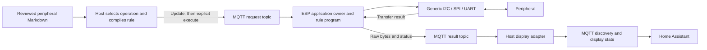

# μT-Home

A configurable embedded platform for INF2004, group AAI13. The project aims
to let a user change how an ESP32-C3 communicates with peripherals at runtime,
without recompiling or reflashing the firmware for each change.

## Resume next session

The professor has approved **uT-Kernel on the ESP32-C3, MQTT for commands and
results, Home Assistant MQTT discovery for display, and a rule-based decision
program on the ESP**. This approval was recorded from the user's confirmation
on 13 November 2026. The earlier ESPHome-native-API display choice is superseded.
Keep and simplify this repository; a firmware rewrite is not the plan.

Work in this `Revised` checkout. Check Git status and the relevant area guide.
The maintained host compiler and client are now in
[tools/transaction](tools/transaction/README.md), with current examples in
[configs/transactions](configs/transactions). Markdown compiles directly to the
current `TJ` rules. The ESPHome/native API and old USB `TR` proof are retired.

The `TJ` v2 session/status contract is implemented and software-tested. The host
can query boot identity, generation, active rule and pending/completed command
state; commands and replies carry the boot identity. Wire messages remain 96
bytes, with device identifiers now limited to 15 characters. Old v1 transaction
JSON/packets must be replaced; the examples and compiler emit v2.

The [persistent host controller](tools/transaction/README.md#persistent-controller)
now owns IDs/revisions, rule selection/loading/execution, durable pending commands
and display expiry. Software tests use the compiled C owner and a real local
TLS MQTT broker, including lost replies and host/broker restarts without repeated
I/O. The command-line session needs no UI changes. ESP restarts and generation
changes are injected in C fixture tests. The live BMP388 MQTT check below now
also covers rule switching, host reopen and broker recovery on the board.
Generated verification is local-only under `build/controller/`.

**Current priority: finish MQTT TLS transport and resource work.**
At the user's request on 17 November, the [ESP HTTPS service](firmware/src/network/README.md#esp-https-removal)
and its host setup commands are removed. Full saved-profile setup/recovery uses
USB; runtime rules/results use MQTT over verified TLS. The host Configuration Desk
and Home Assistant web interfaces are unchanged. The latest candidate was
[temporarily tested on the board](tools/transaction/README.md#backed-up-tls-board-comparison);
the original full flash was restored and verified afterward.
MQTT now reserves its full-size TLS input/output buffers, retained broker
hostname, typed outer handshake state, temporary certificate head and retained
peer fingerprint; see the
[resource assessment](docs/reports/wifi-static-memory/README.md#current-network-resource-assessment).
TLS derivation now also reserves its 64-byte seed and 22-byte label copies,
with native-task isolation from Wi-Fi's PSA allocations. Secret/key copies
remain heap-backed; this does not complete TLS memory qualification.
Continue with the remaining inner certificate/key, secret and TCP/IP allocations.
The [certificate record work](docs/reports/wifi-static-memory/README.md#fixed-peer-certificate-records)
preserves the native validation and renegotiation lifecycle. The user approved
[disabling session tickets](docs/reports/wifi-static-memory/README.md#mqtt-session-tickets-disabled)
on 17 November: accepted tickets exceed available headroom, and the application
does not reuse saved sessions. Reconnects retain full verified TLS handshakes.
The [fixed handshake-state stores](docs/reports/wifi-static-memory/README.md#fixed-tls-handshake-state)
retain active records while renegotiation prepares replacements. Scoped setup
and both renegotiation entries preserve SDK ownership and deterministic exhaustion.
The simulated Runtime Desk and Home Assistant walkthrough is complete. Continue
TLS checks and request operator input when needed; that work is no longer deferred. The
[MQTT connect retry correction](firmware/src/network/README.md#mqtt-tls-connect-retry)
now passes software checks and a fresh target build. The approved cumulative
candidate answered initial and post-broker-restart status queries, then timed
out on the normal profile before any idle Apply. Resource
compliance remains a final gate.

The [Home Assistant display adapter](tools/transaction/README.md#home-assistant-display)
is implemented on the host. Add `--home-assistant` to the existing controller
session to publish six read-only entities from its copied state. Real-broker and
compiled-C software tests cover A/B/A switching, zero bytes, expiry, failures and
restarts without extra peripheral operations. The subsequent live trial received
six discovery definitions and a ready-state display over MQTT, but completed no
new rule load or execution: status replies became intermittent after applying the
idle plan. Home Assistant OS 18.4 / Core 2026.11.1 was installed and connected to
the broker, but its local VM repeatedly stalled. Combined display acceptance is
still open. See the [trial limits](tools/transaction/README.md#current-live-trial);
local-only evidence is under `build/homeassistant/` and
`build/homeassistant-live-20261115/`.

The [MQTT status investigation](tools/transaction/README.md#mqtt-status-investigation)
on 16 November reproduced idle-plan timeouts, but also observed MQTT timeouts
and ping loss on the normal profile. A plan change can inherit a 30-second
reconnect backoff; later delays/disconnections and one unattended reset during
Apply remain unexplained. Those trials established no firmware fix. Home Assistant VM
instability remains a separate unresolved issue. A later check kept the normal
profile fixed and captured repeated TCP packets with delayed acknowledgments.
The local broker and hotspot gateway responded promptly; moving the phone closer
did not clear ESP packet loss. The board's firmware and saved profile are unchanged.
An approved original/diagnostic/original firmware comparison then showed lower
ping latency with modem sleep disabled, but initial MQTT timeouts persisted in
both modes. The original full flash was restored and verified; no fix was kept.
TLS work was paused at that checkpoint while HA integration proceeded.

The separate [HA VM check](tools/transaction/README.md#home-assistant-vm-check)
passed six-sensor A/B/A, expiry, HA Core restart and host-reopen checks using
the compiled C owner with simulated buses and HA's authenticated state API.
The VM still stalled during shutdown with HPET enabled; it is not a stable host.
The approved [HA Container in WSL2](tools/transaction/README.md#home-assistant-container-in-wsl2)
is now running at `http://127.0.0.1:18123`. The isolated six-sensor check passed
with simulated buses, including HA and MQTT restarts without extra operations.
Both containers stopped cleanly, the WSL environment restarted successfully,
and all 30 API probes over five minutes passed in 3–25 ms. The user confirmed
that the dashboard loads normally. On 17 November, the user also verified all
six rendered sensors through chip-ID / raw-pressure / chip-ID switching,
result expiry and display disconnection using the simulated fixture. This is
separate from physical ESP acceptance. The old VM remains stopped with recovery
copies saved.

Use the local `build/homeassistant-wsl-20261116/start-ha.ps1` and `stop-ha.ps1`
helpers described in the guide. The start helper keeps this dedicated WSL
environment alive; systemd services alone did not keep it running. Login details,
test configuration, backups and verification are private under that ignored
folder. The fixture is stopped, so its six sensors are correctly unavailable.

**Next: investigate the later normal-profile MQTT stall and complete the
remaining TLS storage design.** The approved board comparison returned 10/10
candidate replies initially and 10/10 after broker restart, then 0/5 before
the proposed idle Apply. Both restarted-original controls returned 0/10.
The idle test stopped at its readiness guard; no profile or transaction changed.
The cumulative image does not isolate the retry correction's individual effect.
The original full flash/profile and laptop network are restored. Packet loss,
the unattended Apply reset and old VM instability remain open.
The reviewed SPI/UART operation descriptions follow this work.
The approved compact Runtime transactions tab is available in the existing
[Configuration Desk](tools/configurator/README.md#runtime-transactions): choose
a description, operation and address, then Load rule and Execute active rule.
The new HTTP path passed the simulated A/B/A, expiry and journal-reopen check
through MQTT and HA, with exactly three reads. Backend and desktop/mobile browser
checks passed. The user then completed the
[operator walkthrough](tools/configurator/README.md#simulated-operator-walkthrough):
preview versus active rule, three explicit A/B/A reads, expiry and disconnect,
with all six HA sensors unavailable afterward. Physical ESP/HA acceptance remains
separate. The local HA container and simulated six-sensor visual check are ready. A
[repeatable demo](tools/transaction/README.md#repeatable-simulated-display-demo)
is available without the physical ESP. Physical ESP/HA acceptance stays open
until transport work is resumed and MQTT readiness is repeatable.
The [power-save comparison](tools/transaction/README.md#normal-profile-packet-capture)
is complete, with the original image/profile restored and no root-cause claim.
Complete the reviewed SPI/UART descriptions before their physical demonstrations;
confirm current equipment and wiring before board work. Preserve the existing visual
style and review proposed UI adjustments before implementation. See the
[completion plan](CONTRIBUTING.md#completion-plan).

**Final resource acceptance remains open.** The latest target fits unchanged
fixed-memory budgets after removing HTTPS, but reachable TLS/TCP/IP heap
paths remain. The bounded board trial does not qualify runtime resource peaks.
Smaller TLS records can still break valid broker certificate chains, so working
limits stay unchanged. The
[resource assessment](docs/reports/wifi-static-memory/README.md#current-network-resource-assessment)
retains the implemented fixed-storage changes, build identities and unresolved
capacity/lifetime work. Its generated evidence remains under ignored `build/`;
none of the host display tests qualifies target memory, timing or stack use.

The [live network check](firmware/src/network/README.md#current-hardware-check)
on 15 November 2026 established working Wi-Fi with the full project firmware.
Correct the configured SSID's exact spelling and use the reviewed private
10 dBm startup/runtime setting for this board. The unchanged SDK example
connected at a 10 dBm startup limit and repeatedly failed at 20 dBm; the earlier
runtime-only override did not limit startup. The project now derives and checks
both settings. It connected after an ESP restart and automatically recovered
after a hotspot off/on cycle. Authenticated, certificate-verified HTTPS identity
and status reads succeeded.

The follow-up [live MQTT check](firmware/src/network/README.md#live-mqtt-check)
passed on that same firmware: Markdown-selected BMP388 reads changed from one
received byte to three and back, an invalid update was rejected by the ESP while
preserving the previous rule, and broker recovery retained the exact cached
completion. HTTPS reads succeeded alongside MQTT. SPI/UART runtime-rule tests,
physical Home Assistant/UI integration and resource acceptance remain open.
Those HTTPS read observations describe the earlier installed image; HTTPS is no
longer part of the maintained firmware.

The fixed project image is installed with private bench settings; active/saved
profile contents are now restored under revision 943, with the original CRC
3623560383. The final 16 November snapshot showed fresh BMP388/radar samples
and transfers from all three workers with no reported errors/timeouts. No new
firmware was flashed. The full original flash backup is retained. Private
settings, captures and image identities remain local-only under
`build/mqtt-idle-20261116/`, `build/mqtt-20261115/` and
`build/wifi-20261115/`; earlier observations are under
`build/bench-20261114/`. Confirm the current port, hotspot and broker address
before reusing any bench setup; the temporary broker is not a persistent service.

The existing configuration application and peripheral profiles remain for setup
and recovery. Runtime transactions require an explicitly idle peripheral plan.
Do not assume current equipment, port, wiring or installed firmware. Separate
host tests, target builds and physical acceptance.

<a id="platform-contract"></a>

## Target workflow

1. Prepare a few concise, reviewed Markdown peripheral descriptions
   based on datasheets. They contain the communication details needed for the
   supported examples. Automatically extracting PDFs is outside this scope.
2. On the host, the user selects a peripheral and an operation such as read or
   write. Host code turns the selected description and operation into a
   configuration or set of rules for the ESP.
3. The host sends the configuration over Wi-Fi using MQTT. The intended ESP
   decision program validates and applies the rules while running, then decides
   how the appropriate generic I²C, SPI or UART driver should communicate.
4. The generic driver performs the configured transaction. The ESP returns raw
   response bytes and status over MQTT. The host shows the result and publishes
   Home Assistant discovery and display messages; the user interprets the bytes.
5. Send different rules and demonstrate a changed transaction without
   rebuilding or reflashing the ESP. Show the active configuration and the
   actual decision and result so the runtime change is observable.

The decision component is a configurable rule-based program. The host obtains
explicit communication fields from the reviewed description; the ESP validates
and stores a rule, then selects the driver, outgoing bytes and receive length
when execution is requested. Loading a rule performs no peripheral I/O. No
trained weights, labelled dataset, automatic PDF interpretation or sensor-value
decoding is required. The bounded `TJ` contract, fixed wiring and supported
transfer shapes are linked from the transaction component guide.



All MQTT topics use the same broker. The host adapter now publishes discovery
and state from the command-line controller. The Configuration Desk view and
combined live Home Assistant/ESP
acceptance remain to be completed.
MQTT discovery registers Home Assistant entities; state topics supply their
values. See the [Home Assistant MQTT documentation](https://www.home-assistant.io/integrations/mqtt/#mqtt-discovery).

<a id="current-status"></a>

## Existing work and boundaries

Supported transfers are bounded; one firmware image does not imply support for
every peripheral protocol. Raw byte accuracy/decoding is not the demonstration
objective, but configured operations, actual status and limits must be honest.

Historical AI, framework comparisons and qualification archives were removed
from this checkout at the user's request. Current coding-policy approvals and
pinned dependencies remain. Fresh generated evidence belongs under ignored
`build/`; never commit private credentials, firmware backups or local references.

<a id="team-responsibilities"></a>
<a id="remaining-work"></a>
<a id="overall-delivery-plan"></a>

## Team and next steps

See the [team workload and integration checkpoints](CONTRIBUTING.md) for
ownership, handoffs and the planned end-to-end demonstration.

## Start here

### Repository layout

```text
firmware/       ESP32-C3 application, portable services, drivers and HAL ports
tools/          Transaction/configuration clients, wiring guide, builds and C tools
catalogue/      Reviewed boards, peripherals and connection presets
configs/        Runtime-rule examples, node profiles and build selections
schemas/        JSON contracts used to validate those inputs
datasheets/     Reviewed peripheral communication notes and source references
tests/          Software suites, board fixture and hardware test procedures
docs/           Cross-project guides, hardware notes and current Wi-Fi resource reports
build/          Local generated output and captured evidence; Git-ignored
```

Add portable firmware logic to the matching `firmware/src/` service, hardware
access to `firmware/hal/ports/`, and device-specific code to `firmware/drivers/`.
Keep host workflows in the relevant `tools/` package and tests in their existing
suite. Extend the area's main README when adding a capability. The
[documentation index](docs/README.md) and [hardware guide index](docs/hardware/README.md)
provide navigation without duplicating the implementation guides.

Keep generated builds, private settings and captured board backups separate
from maintained source. Original briefs, private professor reference code and
superseded Member 5 planning are stored outside this checkout in the sibling
`../Project References/` folder on this workstation. Its README records their
locations. These local reference files are not build inputs or shared project
requirements; use the current guides below for development.

### Area guides

| Purpose | Guide |
|---|---|
| Workload, interfaces and deliverables | [Team workload](CONTRIBUTING.md) |
| Set up or build the existing firmware | [Firmware](firmware/README.md) |
| Existing hardware wiring and acceptance procedures | [Hardware acceptance](HARDWARE_ACCEPTANCE.md) |
| Existing configuration application | [Configuration Desk](tools/configurator/README.md) |
| Existing network work and limitations | [Network](firmware/src/network/README.md) |
| Current rule-based decision work | [Transaction service](firmware/src/services/transaction/README.md) |
| Existing firmware contracts | [Shared contracts](firmware/CONTRACTS.md) |
| Software tests | [Tests](tests/README.md) |
| Required C policy | [BARR-C project standard](C_CODING_STANDARD.md), [agent rules](AGENTS.md) |

All new or changed project-owned C must follow BARR-C:2018 and the project
standard, including the pinned formatting/checker gate, manual review and
affected tests. Target changes require the applicable real-target build and new
evidence. The team is responsible for understanding and reviewing all code,
including code produced with AI assistance. Document testing and results in the
project report and raise blockers with the professor promptly.
