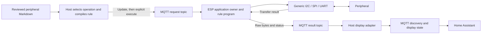

# μT-Home

A configurable embedded platform for INF2004, group AAI13. The project aims
to let a user change how an ESP32-C3 communicates with peripherals at runtime,
without recompiling or reflashing the firmware for each change.

## Resume next session

The professor has approved **uT-Kernel on the ESP32-C3, MQTT for commands and
results, Home Assistant MQTT discovery for display, and a rule-based decision
program on the ESP**. This approval was recorded from the user's confirmation
on 13 November 2026. The earlier ESPHome-native-API display choice is superseded.
Keep and simplify this repository; a firmware rewrite is not the plan.

Work in this `Revised` checkout. Check Git status and the relevant area guide.
The maintained host compiler and client are now in
[tools/transaction](tools/transaction/README.md), with current examples in
[configs/transactions](configs/transactions). Markdown compiles directly to the
current `TJ` rules. The ESPHome/native API and old USB `TR` proof are retired.

Start with session/restart semantics and the network resource audit,
then the persistent host controller, three-protocol Markdown coverage, UI and
Home Assistant display. Validate the actual Wi-Fi/TLS path early when equipment
is available. The host display adapter remains unimplemented and must remain
running for Home Assistant updates. See the [completion plan](CONTRIBUTING.md#completion-plan)
for the reviewed gaps, delivery order and acceptance criteria.

The existing configuration application and peripheral profiles remain for setup
and recovery. Runtime transactions require an explicitly idle peripheral plan.
Do not assume current equipment, port, wiring or installed firmware. Separate
host tests, target builds and physical acceptance.

<a id="platform-contract"></a>

## Target workflow

1. Prepare a few concise, reviewed Markdown peripheral descriptions
   based on datasheets. They contain the communication details needed for the
   supported examples. Automatically extracting PDFs is outside this scope.
2. On the host, the user selects a peripheral and an operation such as read or
   write. Host code turns the selected description and operation into a
   configuration or set of rules for the ESP.
3. The host sends the configuration over Wi-Fi using MQTT. The intended ESP
   decision program validates and applies the rules while running, then decides
   how the appropriate generic I²C, SPI or UART driver should communicate.
4. The generic driver performs the configured transaction. The ESP returns raw
   response bytes and status over MQTT. The host shows the result and publishes
   Home Assistant discovery and display messages; the user interprets the bytes.
5. Send different rules and demonstrate a changed transaction without
   rebuilding or reflashing the ESP. Show the active configuration and the
   actual decision and result so the runtime change is observable.

The decision component is a configurable rule-based program. The host obtains
explicit communication fields from the reviewed description; the ESP validates
and stores a rule, then selects the driver, outgoing bytes and receive length
when execution is requested. Loading a rule performs no peripheral I/O. No
trained weights, labelled dataset, automatic PDF interpretation or sensor-value
decoding is required. The bounded `TJ` contract, fixed wiring and supported
transfer shapes are linked from the transaction component guide.



All MQTT topics use the same broker. The diagram is the planned complete path;
the host display adapter remains to be built.
MQTT discovery registers Home Assistant entities; state topics supply their
values. See the [Home Assistant MQTT documentation](https://www.home-assistant.io/integrations/mqtt/#mqtt-discovery).

<a id="current-status"></a>

## Existing work and boundaries

Supported transfers are bounded; one firmware image does not imply support for
every peripheral protocol. Raw byte accuracy/decoding is not the demonstration
objective, but configured operations, actual status and limits must be honest.

Historical AI, framework comparisons and qualification archives were removed
from this checkout at the user's request. Current coding-policy approvals and
pinned dependencies remain. Fresh generated evidence belongs under ignored
`build/`; never commit private credentials, firmware backups or local references.

<a id="team-responsibilities"></a>
<a id="remaining-work"></a>
<a id="overall-delivery-plan"></a>

## Team and next steps

See the [team workload and integration checkpoints](CONTRIBUTING.md) for
ownership, handoffs and the planned end-to-end demonstration.

## Start here

### Repository layout

```text
firmware/       ESP32-C3 application, portable services, drivers and HAL ports
tools/          Transaction/configuration clients, wiring guide, builds and C tools
catalogue/      Reviewed boards, peripherals and connection presets
configs/        Runtime-rule examples, node profiles and build selections
schemas/        JSON contracts used to validate those inputs
datasheets/     Reviewed peripheral communication notes and source references
tests/          Software suites, board fixture and hardware test procedures
docs/           Cross-project guides, hardware notes and current Wi-Fi resource reports
build/          Local generated output and captured evidence; Git-ignored
```

Add portable firmware logic to the matching `firmware/src/` service, hardware
access to `firmware/hal/ports/`, and device-specific code to `firmware/drivers/`.
Keep host workflows in the relevant `tools/` package and tests in their existing
suite. Extend the area's main README when adding a capability. The
[documentation index](docs/README.md) and [hardware guide index](docs/hardware/README.md)
provide navigation without duplicating the implementation guides.

Keep generated builds, private settings and captured board backups separate
from maintained source. Original briefs, private professor reference code and
superseded Member 5 planning are stored outside this checkout in the sibling
`../Project References/` folder on this workstation. Its README records their
locations. These local reference files are not build inputs or shared project
requirements; use the current guides below for development.

### Area guides

| Purpose | Guide |
|---|---|
| Workload, interfaces and deliverables | [Team workload](CONTRIBUTING.md) |
| Set up or build the existing firmware | [Firmware](firmware/README.md) |
| Existing hardware wiring and acceptance procedures | [Hardware acceptance](HARDWARE_ACCEPTANCE.md) |
| Existing configuration application | [Configuration Desk](tools/configurator/README.md) |
| Existing network work and limitations | [Network](firmware/src/network/README.md) |
| Current rule-based decision work | [Transaction service](firmware/src/services/transaction/README.md) |
| Existing firmware contracts | [Shared contracts](firmware/CONTRACTS.md) |
| Software tests | [Tests](tests/README.md) |
| Required C policy | [BARR-C project standard](C_CODING_STANDARD.md), [agent rules](AGENTS.md) |

All new or changed project-owned C must follow BARR-C:2018 and the project
standard, including the pinned formatting/checker gate, manual review and
affected tests. Target changes require the applicable real-target build and new
evidence. The team is responsible for understanding and reviewing all code,
including code produced with AI assistance. Document testing and results in the
project report and raise blockers with the professor promptly.
