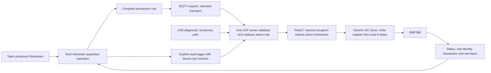

# Runtime transaction rules: feasibility experiment

This component belongs to Member 4. It was prototyped at teammate commit
`7f0c86e` and is now integrated with the Buddy 1 source in `Revised`.
Run commands below from the repository root.

The objective is to change how the ESP communicates with a peripheral after
building firmware. The host supplies a complete rule; a fixed program on the
ESP admits it and selects the transaction when asked to read. Raw bytes return
to the host. This is a runtime decision program, not a trained classifier or a
claim of automatic datasheet understanding or sensor accuracy. Team-written
Markdown descriptions now feed a deterministic host compiler; see the
[six descriptions and authoring contract](../../datasheets/README.md). The host
selects a named operation and emits the existing rule JSON plus a provenance
report. It never extracts PDFs at runtime. The earlier USB proof used the two
JSON fixtures; the Markdown compiler reproduces those exact BMP388 rules in
software tests, without rewriting that historical hardware evidence.

## Selected interface and consultation

The user selected **the existing uT-Kernel firmware with an ESPHome native API
for Home Assistant display**, with MQTT carrying rule updates and raw results.
Professor approval is not recorded. The actual ESPHome external component builds for ESP32-C3, but
its ESP-IDF runtime uses FreeRTOS and its I2C implementation, rather than the
required uT-Kernel and project generic driver. Its C++ framework uses dynamic
storage. Runtime rule changes are feasible without regenerating YAML; that
alone does not establish compatibility with the project's kernel, driver,
language or memory requirements. Present this comparison to the professor.

The teammate's native API is a **read-only occupancy connectivity reference**.
It does not yet display general transaction results. MQTT handles rule updates
and raw results; the current MQTT client is a publisher only and does not
subscribe to commands. The USB proof is not evidence of MQTT integration.

Private lab setup accepts both the ESPHome native API and MQTT settings at once.
A host test drives the native display and MQTT publisher state machines together
using separate socket/TLS doubles. The existing real ESPHome client test separately
exercises the display endpoint through loopback. Neither demonstrates on-board
coexistence or an MQTT command subscriber. The existing native listener is
plaintext and unauthenticated; deployment security and resource costs remain open.

### Integration work remaining

1. Extend the MQTT session to subscribe to a bounded, device-specific rule topic,
   assemble complete requests, reject unsupported packets and re-subscribe after
   reconnect. The present publisher only accepts CONNACK and PINGRESP; it cannot
   receive a rule. Preserve TLS and the existing single-owner service model.
2. Deliver a copied request to the application/configuration owner. Resolve the
   actual bus and device, serialize against apply and affected workers, then call
   `txwire` and the generic driver. Define bounded backpressure and what happens
   when a plan changes, a reply cannot be sent, or a request is repeated.
3. Publish the complete 65-byte result via MQTT and expose a copied, bounded
   display snapshot through the native API. Define entity names, unavailable and
   stale behavior with Member 3; the current entities only describe radar status.
4. Verify independent native API clients, MQTT fragmentation, invalid updates,
   A->B switching, failures and reconnects in host tests. Build a real target
   image under the C standard gate; then measure resources and test both services
   together on hardware before claiming the integrated path works.

These are implementation tasks, not existing capabilities. The experimental MQTT
topic names and QoS-zero wire format below are provisional until agreed with the
networking and integration owners.

| Question | Actual ESPHome experiment | Existing firmware experiment |
|---|---|---|
| Update path | MQTT request -> external component -> shared C validator | Temporary USB frame -> application owner -> same C validator |
| Decision owner | ESPHome main-loop MQTT callback | Existing uT-Kernel initial/application task |
| Driver | ESPHome I2C `write_readv` | `txi2c` -> existing `geni2c` -> `i2cbus` -> `c3i2c` |
| Trigger | Explicit read message, no polling timer | Explicit read message, no sensor worker |
| Result | Non-retained binary MQTT reply | Binary USB reply |
| Debug isolation | Separate generated image; only one I2C component | Explicit `--rule-probe` image; normal config/worker/radio paths inactive |
| Target | ESP32-C3 build passes | ESP32-C3 build/qualification and USB bench proof pass |
| Kernel | ESP-IDF 5.5.6 / FreeRTOS | Pinned uT-Kernel with existing ESP-IDF 6.1 adaptation |
| C policy | Shared C99 core checked; framework boundary is C++ | All owned C checked by the repository gate |
| Resources | Framework heap/tasks remain unqualified | No new worker slot; existing runtime pool and bus mutex; whole-system cost unqualified |
| Missing proof | Live MQTT, on-board A->B, framework acceptability | USB A->B passed; production MQTT arbitration pending |

## Workflow and ownership



Updating a rule performs no bus transfer. Reading invokes at most one driver
callback. A rejected update leaves the previous rule active. No state persists
over reboot. The requester must supply the intended device/revision; mismatches
produce an explicit error and no I/O. Zero response bytes are valid data.

For production uT-Kernel integration, Member 2's network service should deliver
a copied, bounded rule request to Member 5's existing configuration owner.
That owner must arbitrate with configuration apply and stop/quiesce affected
workers before changing bus claims. It then owns `txrule_load`/`txrule_execute`
and hands copied replies back for MQTT publication. Do not execute bus calls
from a competing network callback or consume another worker's sensor FIFO.
This experiment does not implement that production integration or add a task.

## Provisional contract v1

One active rule contains `version` (exactly 1), nonzero uint32 `revision`,
`device` (1-31 ASCII letters/digits/underscore/hyphen), seven-bit `address`
(0x08-0x77), one `register` byte (0-255), and `read_length` (1-16).
`host.py` validates the JSON object and the C core independently validates the
executable fields. Extra JSON keys are rejected. C names have a zero-filled
32-byte field. The rule is copied into caller-owned storage only after complete
validation. The owner must serialize calls; there is no cross-task atomic swap.

The operation is a **one-byte register-pointer write followed by a repeated
START and N-byte read**, with no intervening STOP or delay. It does not express
arbitrary I2C protocols, sensor initialization, SPI, UART, output writes or
multi-operation models. Address validity does not establish safe device-specific
register semantics; only the reviewed fixtures are proposed for this bench.

The MQTT topics are `uthome/rule-lab/request` and `uthome/rule-lab/reply`.
Use one controller, QoS 0 and `retain=false`. No automatic retries, duplicate
suppression, authentication, persistence or production admission queue is
claimed. This lab endpoint must not be exposed to untrusted publishers.

Wire integers use explicit little-endian encoding, independent of C layout:

| Byte offset | Request (48 bytes) | Reply (65 bytes) |
|---|---|---|
| 0-1 | ASCII `TR` | ASCII `TR` |
| 2 | Version 1 | Version 1 |
| 3 | 1=update; 2=read | Echo kind; 0 if undecodable |
| 4-7 | Request ID uint32 | Echo ID; 0 if envelope invalid |
| 8-11 | Candidate/expected revision | Active revision |
| 12-43 | Device, NUL-terminated and zero-padded | Active device |
| 44 | Update address; zero for read | Active address |
| 45 | Update register; zero for read | Active register |
| 46 | Update response length; zero for read | Active response length |
| 47 | Reserved, zero | 0=ok, 1=invalid, 2=unconfigured, 3=mismatch, 4=timeout, 5=I/O |
| 48 | Absent | Response size, 0 on failure/update |
| 49-64 | Absent | Up to 16 raw bytes; remaining bytes zero |

For the USB lab only, send exactly one 48-byte request and await one 65-byte
reply. Partial I/O is assembled with a two-second budget after the first byte;
reply writes are at most 48 bytes per USB packet. After a timeout, wait more
than two seconds before reopening. There is no stream resynchronization or
retry contract. Production MQTT delivers whole messages to the wire decoder.

## Reviewed BMP388 transactions

The connected board was identified as ESP32-C3 revision 0.4, MAC
`d4:05:92:e6:c3:bc`, 4 MB flash. Initial read-only queries reported a working
BMP388 under saved/active profile revision 931, CRC32 3623560383. Its reviewed
profile uses I2C0, SDA GPIO0, SCL GPIO1 and address 0x77. The diagnostic uses
100 kHz. Reconfirm identity and wiring before future bench sessions; COM8 is
an observation, not a fixed requirement. Keep existing wiring intact.

| Rule | Register byte sent | Bytes requested | Meaning of the proof |
|---|---|---|---|
| A, revision 1 | `00` | 1 | Chip ID; BMP388 specifies `50` |
| B, revision 2 | `04` | 3 | Raw pressure register window `04..06` |

Reviewed against Bosch `BST-BMP388-DS001-07`, revision 1.7 (November 2020):
pages 31-32 for registers and page 41, section 5.2.2 for register reads and
auto-increment. Local source is the supplied
`ESP/Datasheets/bst-bmp388-ds001.pdf`. Reading pressure data clears its data-ready
flag. No pressure conversion setup is issued by this probe; bytes may be zero
or reflect previous state. They establish communication shape only.

## Reproduce the software proof

Use Python and GCC on PATH, and the pinned clang-format 20.1.8 selected through
`BARR_CLANG_FORMAT` as described in the root C policy. Assertions stay enabled.

```powershell
python tools/c_standard/check.py
python -m unittest tests.target.test_transaction tests.target.test_build_modes tests.target.test_qualification tests.target.test_generic_i2c tests.target.test_ci_workflow
python experiments/runtime_rules/host.py --mode offline
```

The demo compiles one library, loads it once, applies A, reads, applies B, reads,
rejects a length-17 update, then reads B again. Expected simulated bytes are `00`
and `00 01 02`; they are explicitly not hardware observations. The simulator
records actual address/register/write/read counts below the real generic driver.
Tests cover first/last allowed address/register/length, malformed/truncated
frames, full-width C validation, device/revision mismatch, rejected-update
preservation, zero bytes and injected timeout/NACK/I/O failures without stale
data. Reports and binaries stay under ignored `build/`.

Actual ESPHome build (ESPHome 2026.10.2, paho-mqtt 1.6.1):

```powershell
python -m venv build/esphome-env
build/esphome-env/Scripts/python -m pip install -r experiments/runtime_rules/requirements.txt
python experiments/runtime_rules/prepare_esphome.py
build/esphome-env/Scripts/esphome compile build/esphome-runtime/device.yaml
```

The staged component copies the shared C source and records its hashes.
`compile_policy.cmake` applies C99 and warnings-as-errors to the owned sources;
verify effective flags in `build/esphome-runtime/build/build/compile_commands.json`.
The underscore device name is intentional for the supported CMake project hook.
Placeholder Wi-Fi/broker settings allow compilation only. A later private
`--secrets PATH` file can provide `wifi_ssid`, `wifi_password`, `mqtt_broker`.
Do not commit it. The later live command is:
`python experiments/runtime_rules/host.py --mode mqtt --broker BROKER`.
No live MQTT evidence is claimed in this milestone's current USB-only bench.

Build the native diagnostic with the existing pinned SDK environment:

```powershell
python tools/target/qualify_kernel.py build --runtime-port --configuration-app --static-net-queues --rule-probe --kernel PATH_TO_PINNED_KERNEL --work-dir NEW_PATH_WITHOUT_SPACES --compat-patch firmware/third_party/patches/0002-esp-idf-6.1-build.patch --resource-patch firmware/third_party/patches/0001-uthome-c3-resources.patch
```

Use a fresh output directory. Qualification checks source identity, effective
compiler flags, partition layout and absence of normal configuration/radio entry
paths. No image installation is part of that command. After backup and explicit
installation approval, the read-only bench command is:
`python experiments/runtime_rules/host.py --mode usb --serial-port CONFIRMED_PORT --output build/usb-proof`.
Keep the original firmware backup outside Git and restore it after testing.

## Manual BARR-C review and resource limits

Reviewed `txrule`, `txwire`, `txi2c`, `txsim`, `c3rule`, the `c3app` opt-in entry
and their headers against the root manual checklist:

| Review area | Finding |
|---|---|
| Language, casts, ABI | C99, paired headers, named callback signatures; integer narrowing follows validated bounds. Wire decode uses bytes and unsigned shifts, never unaligned integer casts. C++ adapter contains the ESPHome API boundary. |
| Formatting, comments, modules | Maintained module form, private declarations before public functions, private implementations after; contracts identify borrowed lifetime, serialization and diagnostic scope. Pinned formatter and full gate required. |
| Types and initialization | Explicit uint32 wire fields; size_t sizes; Boolean state; all request results and scratch buffers initialized. No floating-point or generated model-specific C. |
| Lifetime and concurrency | Rule copied, no borrowed message retained; disjoint caller buffers required. One owner changes configuration and claims. Callback context casts restore their original type. No interrupt-shared new state or volatile workaround. |
| Bounds and errors | Name scan <=32 bytes; integer encode loops exactly 4; response copy <=16; one driver call/read. Every failed read returns zero usable bytes. Failed replacement preserves active state. Bus claims released after transfer; failed cleanup remains blocked rather than reused. |
| Hardware/task behavior | Existing generic driver and native bus guard used. Fixed bus pins in opt-in diagnostic, 50 ms transfer deadline, yielded USB waits, no new worker or post-startup kernel objects. SDK/bus behavior and whole-system timing still require bench evidence. |

No exception or language-policy expansion is introduced. The core has no heap
or hardware calls. Host ABI sizes are rule 52, state 56 and result 76 bytes;
these are not target stack measurements. `txwire_process` has local candidate
and result storage and invokes `txrule_execute` with a 16-byte scratch buffer.
The target ELF confirms rule state 56 bytes, generic-driver adapter 20 bytes,
and request/reply buffers 48+65 bytes: 189 bytes of symbol payload, excluding
alignment. The diagnostic application image is 157600 bytes; its ELF reports
text 151580, data 5896 and BSS 267622 bytes across the whole diagnostic. Existing bus and kernel storage is additional.
ESPHome's build reports static DRAM 104674 bytes and app flash 848962 bytes;
framework heap, peak stack, scheduling/combined-load costs are not qualified.

The consolidated source also built the native rule diagnostic on 2026-11-07 in
`C:/Users/kkak4/esp/uthome-cleanup-rule-20261107-r4/`. This is a fresh build,
not a new hardware observation; the existing USB proof below refers to its
original image. The independently built Wi-Fi diagnostic currently fails its
[linked memory-budget check](../../firmware/src/network/README.md#integration-review-static-task-alignment).

## Evidence and remaining work

Historical experiment evidence has been copied and hash-verified under
`build/evidence/runtime-rules-20261107/` (see `preservation-sha256.json`).
The original worktree records refer to paths relative to that worktree.
Original generated evidence includes `build/runtime-rules/{build,demo}.json`,
`build/regression.log`, `build/esphome-build.log`,
`build/esphome-runtime/source-manifest.json`, and the fresh native build's
`evidence.json`, map, ELF and source manifest. The initial board query is
`build/bench-initial-20261107-081256.json`; chip/flash detection is
`build/bench-flash-id.txt`. The full original backup is stored outside this
repository at `C:/Users/kkak4/esp/hardware-backup-rule-proof-20261107/`.
Do not commit backup contents or private settings.

Software simulation, target compilation and physical bus observations must
remain separate in reports. Hardware A->B and restoration passed on 2026-11-07, after explicit user
installation approval. Live Wi-Fi/MQTT is deferred by the user. Full three-bus
support, free-form Markdown interpretation, production arbitration, trained ML,
persistence, UI changes and physical sensor accuracy are later work.

### Completed software and USB observations (2026-11-07)

- Full C gate: 365 files, zero findings, pinned formatter; manual review above.
- Host/rule/driver/build/CI regression suite: 67 tests passed. Existing MQTT,
  broker and configuration transport regressions: 35 tests passed (software
  doubles only). The latter use `PYTHONPATH=tests/target` and modules
  `test_network_mqtt`, `test_network_broker`, `test_network_config`,
  `test_network_config_client` under `tests.target`.
- Actual ESPHome target build passed; effective owned C99 warning profiles
  verified. Its image was not installed. Local evidence is
  `build/esphome-runtime/build-evidence.json`.
- Native diagnostic build passed in
  `C:/Users/kkak4/esp/uthome-rule-probe-20261107-r2/`. Source hashes, toolchain,
  compiler profiles and isolation checks are in its `evidence.json`.
  App SHA-256: `51c4753c953cec082916f418532de2f11c9c13c0568f914d306cd6236747e55c`.
- On the same running native image, A selected `0x77 / 0x00 / 1` and returned
  `50`; B selected `0x77 / 0x04 / 3` and returned `f4 00 6b`. An invalid length
  17 was rejected; the next read still selected B and returned `17 01 6b`.
  No rebuild/restart occurred between these six requests. Raw B bytes are
  observations, not expected values or accuracy results.
- First USB attempt received no valid reply after ordinary hard reset. An
  explicit `esptool --chip esp32c3 --port PORT --after watchdog-reset run`
  resolved this using the repository's documented workaround. Root cause was
  not established. Retain this failure with the successful run.
- Full original 4 MB backup was restored, and esptool verified its data hash.
  Query confirmed active/saved revision 931 and CRC32 3623560383. BMP388
  telemetry was fresh again. Radar status was faulted both before and after
  this experiment; this work does not resolve radar reliability.

`build/evidence/runtime-rules-20261107/usb-proof/demo.json` retains the unmodified wire-client report. It labels
remote data unverified because a transport message alone cannot attest the
image. `build/usb-proof/bench.json` supplies the observed board/image provenance;
`restore.log` and `restored-state.json` record restoration. The pre-test backup
SHA-256 is `bfc43c9833c531ce44298285410ca4c7ee67c56efebafdc459484884723726c5`.
Older failed build directories/logs are retained; only the r2 build is the
hardware-tested source identity. At the time of that proof no commit, push,
merge or change to the parent main checkout was performed.

References: [ESPHome architecture](https://developers.esphome.io/architecture/overview/),
[external components](https://esphome.io/components/external_components/),
[MQTT component](https://esphome.io/components/mqtt/). The built version's
`esp32/core.cpp` and MQTT dispatch code were also inspected for actual task
ownership; framework behavior is not inferred from an occupancy display.
