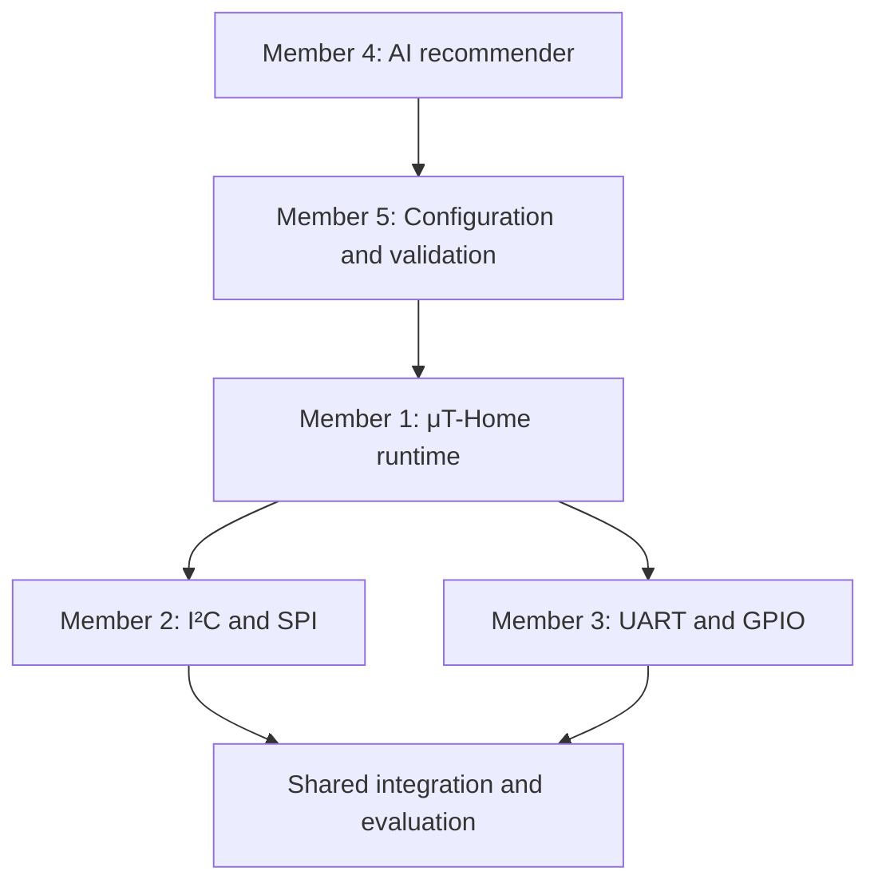

# μT-Home Workload Distribution

## Team Structure

The project will be divided according to the main μT-Home subsystems. Each member will own one technical area and provide a documented interface for the other subsystems. This structure supports parallel development while preserving a single integrated architecture.

| Member | Primary Work Package | Main Responsibilities | Expected Deliverables |
|---|---|---|---|
| **Member 1** | **μT-Kernel Runtime and System Architecture** | Define the common device model. Convert validated configurations into μT-Kernel tasks, timers, message queues, triggers, and actions. Manage task lifecycles and system health. | Generic μT-Home runtime, behaviour engine, task-management interface, runtime health monitoring, and unit tests. |
| **Member 2** | **I²C and SPI Communication Abstraction** | Develop reusable I²C and SPI adapters. Integrate representative peripherals through configuration-driven profiles. Use existing low-level drivers where suitable. | I²C and SPI interfaces, profiles for devices such as the BMP388/B-LUX and OLED, optional W25QXX storage support, and protocol tests. |
| **Member 3** | **UART and GPIO Communication Abstraction** | Develop reusable UART and GPIO adapters. Support digital input, output, interrupts, PWM, and framed UART data. Integrate representative sensors and actuators. | UART and GPIO interfaces, HLK-LD2450 profile, HC-SR04 profile, motor-control profile, timeout handling, and protocol tests. |
| **Member 4** | **Embedded AI Configuration Recommender** | Prepare a structured dataset from supported device specifications. Train and evaluate a compact model. Quantise and deploy the model for ESP32-S3 inference. Recommend device profiles and configuration parameters. | Training dataset, trained and quantised model, inference module, performance evaluation, and documented recommendation outputs. |
| **Member 5** | **Configuration, User Interface, and System Integration** | Define the JSON schema. Generate and validate configurations. Provide a user interface for reviewing recommendations. Transfer profiles and model updates to the ESP32-S3. Coordinate system-level testing and observability. | JSON generator and validator, configuration interface, deployment mechanism, monitoring view, integration-test framework, and final demonstration build. |

## Subsystem Interaction

The AI subsystem recommends a supported device profile and suitable parameters. The configuration subsystem converts the recommendation into validated JSON. The μT-Home runtime interprets the JSON and creates the required μT-Kernel tasks. The communication adapters then perform the requested hardware operations.

## Responsibility Boundaries

### Member 1 — Runtime and Architecture

- Own the generic device and behaviour representation.
- Create, stop, and update μT-Kernel tasks from configuration data.
- Implement timers, queues, events, triggers, conditions, and actions.
- Expose common operations such as `configure`, `read`, `write`, and `publish`.
- Monitor task status, memory use, and runtime failures.

### Member 2 — I²C and SPI

- Implement hardware-independent I²C and SPI interfaces.
- Manage I²C addresses and SPI chip-select assignments.
- Represent peripheral transactions through device profiles.
- Integrate at least one I²C peripheral and one SPI peripheral.
- Verify timing, data integrity, and communication errors.

### Member 3 — UART and GPIO

- Implement UART transmission, reception, and frame handling.
- Implement GPIO input, output, interrupts, pulse timing, and PWM.
- Integrate the HLK-LD2450 as the representative UART peripheral.
- Integrate a GPIO peripheral such as the HC-SR04.
- Demonstrate a configured sensor-to-actuator behaviour.

### Member 4 — Embedded AI

- Define the model inputs and predicted configuration parameters.
- Extract structured specifications from supported datasheets.
- Train and compare compact classification or regression models.
- Quantise the selected model for the ESP32-S3.
- Measure accuracy, model size, memory use, and inference latency.
- Keep model weights separate from the main firmware where feasible.

### Member 5 — Configuration and Integration

- Define required and optional JSON fields.
- Reject invalid protocols, pins, ranges, and duplicate assignments.
- Generate JSON through fixed templates rather than unrestricted text generation.
- Allow users to review, edit, approve, or reject AI recommendations.
- Transfer configurations to the ESP32-S3 without recompiling the runtime.
- Maintain the integration-test harness and final system demonstration.

## Suggested Repository Ownership

| Work Package | Suggested Repository Area |
|---|---|
| Runtime and architecture | `firmware/src/runtime`, `firmware/src/automation`, `firmware/src/health` |
| I²C and SPI abstraction | `firmware/hal/i2c`, `firmware/hal/spi`, `firmware/components/i2c_spi` |
| UART and GPIO abstraction | `firmware/hal/uart`, `firmware/hal/gpio`, `firmware/components/uart_gpio` |
| Embedded AI | `ai`, `models`, `tools/model_converter` |
| Configuration and integration | `firmware/src/config`, `schemas`, `configs`, `tools/configurator`, `tests/integration` |

These paths are provisional. Shared interface files should only be changed after team agreement.

## Shared Responsibilities

All team members will:

- Agree on the device model, JSON schema, and common interfaces.
- Write unit tests for the modules they own.
- Participate in weekly integration tests.
- Review at least one other member's code.
- Record assumptions, limitations, and hardware safety requirements.
- Contribute to fault-injection tests and demonstration rehearsals.
- Understand the complete system sufficiently to explain it during assessment.

## Collaboration Rules

- Create branches using names such as `feat/<module>-<description>`, `fix/<description>`, or `docs/<description>`.
- Use small commits with clear, imperative messages.
- Submit changes through pull requests.
- Require at least one review from another team member.
- Merge only after relevant unit and integration tests pass.
- Obtain team agreement before changing shared interfaces or headers.

## Integration Sequence

1. Finalise the device model, JSON schema, and subsystem interfaces.
2. Test one peripheral independently on each required protocol.
3. Load a manually written JSON profile into the μT-Home runtime.
4. Convert the profile into μT-Kernel tasks, timers, and queues.
5. Demonstrate configuration-driven sensor and actuator behaviour.
6. Train and deploy the compact AI recommendation model.
7. Connect AI recommendations to the JSON generator and validator.
8. Add model and configuration update support.
9. Evaluate timing, memory usage, AI accuracy, and fault handling.
10. Complete the integrated demonstration and documentation.

## Workload Principle

The responsibilities are separated by subsystem rather than by isolated device driver. Members 2 and 3 make different hardware accessible through common interfaces. Member 1 converts descriptions into runtime behaviour. Member 4 recommends suitable profiles and parameters. Member 5 validates, deploys, and monitors the resulting configuration. This arrangement supports the project's central objective: one reusable firmware image with peripheral behaviour determined through configuration.
